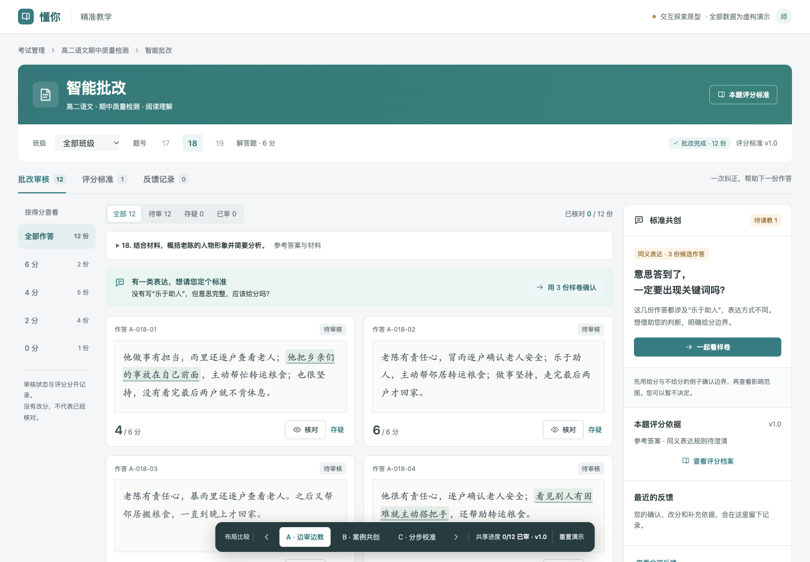
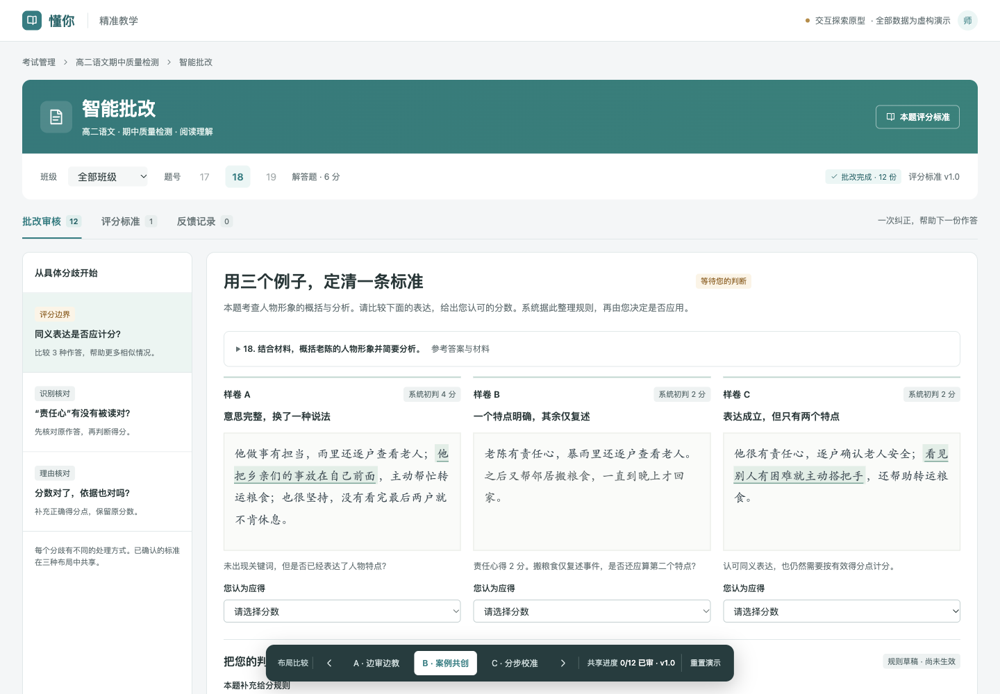
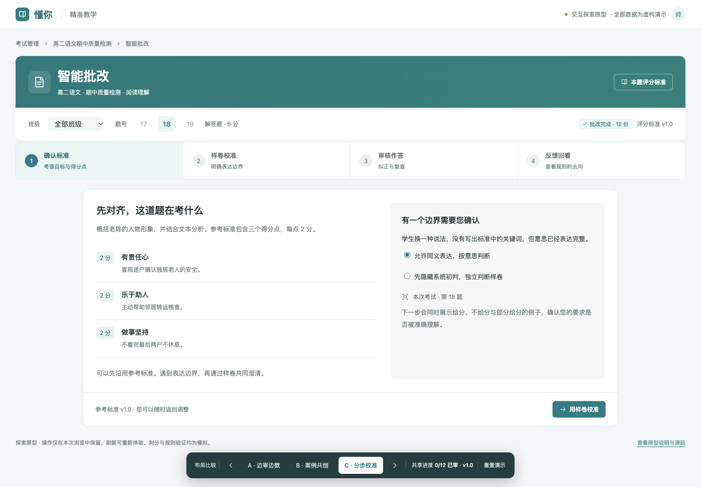
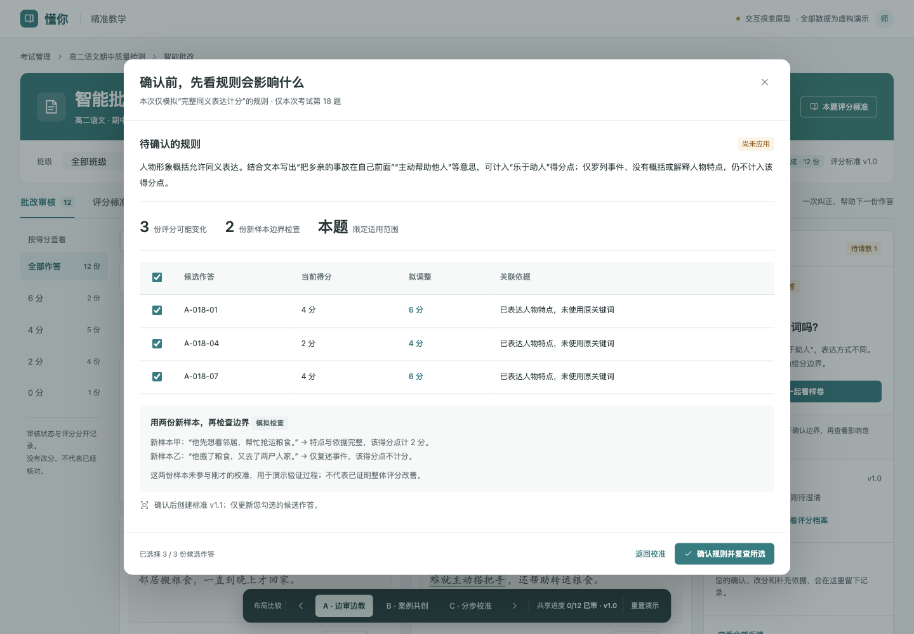

# 智能批改：反馈共创探索原型

体验：[边审边教 A](https://liusf1993.github.io/dongni-prototypes/intelligence-feedback/?variant=A) ·
[案例共创 B](https://liusf1993.github.io/dongni-prototypes/intelligence-feedback/?variant=B) ·
[分步校准 C](https://liusf1993.github.io/dongni-prototypes/intelligence-feedback/?variant=C)

本原型用于讨论交互方案，代码独立编写，全部材料与答卷为虚构数据。
没有复制业务源码、生产截图、凭据、人员信息或真实答卷。
三种布局共享当前标签内的演示状态，刷新或“重置演示”恢复。

## 建议体验
1. 在 A 核对第一份答卷，将 4 分改为 6 分，选“同义表达未计分”，补充原因并保存。
2. 点击“用样卷确认”或“查看规则草稿”，比较三份样卷，分别选择 6、2、4 分。
3. 预览影响：其他评分不改变。取消部分勾选，确认规则并复查。
4. 查看评分档案及反馈记录，再切换 B、C 比较布局；先前状态保留。
5. 重置后体验不确定、评分冲突、识别有误、分数正确但理由需修正等情况。

## 运行
在仓库根目录运行：

    python3 -m http.server 6427 --bind 127.0.0.1

打开 http://127.0.0.1:6427/intelligence-feedback/?variant=A 。
无安装、构建或外部网络依赖。

## 演示边界
- 固定演示第 18 题，其他题号明确禁用。
- 规则预览只模拟“完整同义表达计分”的预设情境。
- 修改规则文字不会调用模型理解，样卷评分与预设边界不一致时禁用应用。
- 新样本检查是演示，不是实际模型评测，不宣称准确率或已训练模型。
- 评分、核对、存疑、记录、分组和复查选择为可操作的前端内存状态。
- 导出仅下载当前演示 JSON，不上传老师输入。
- 切换条只存在于独立原型目录，不进入 fat-web 产品构建。
- 关联 TASK-57；采用何种方案仍待用户体验决定。

## 界面预览

